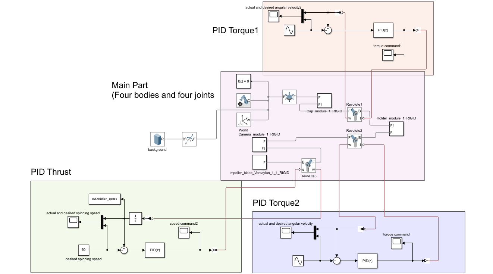
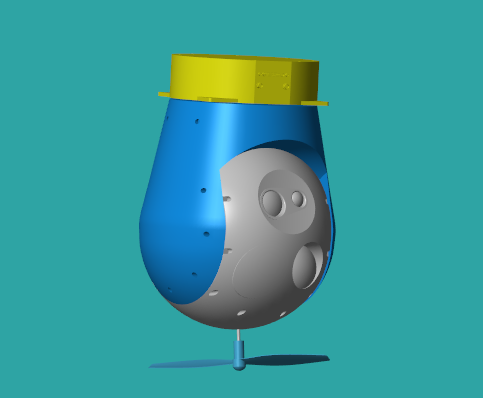
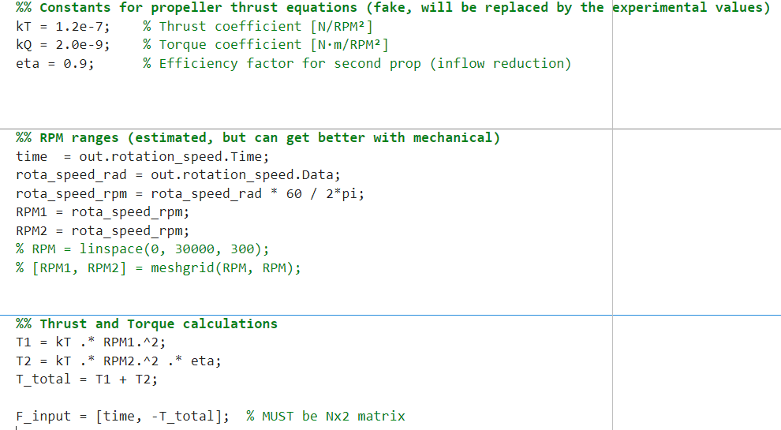

**Basic Process:**

a. Watch Simscape Onramp and Multibody simscape tutorials in Matlab.

b. Download gimbal system and propeller model online, open it in Onshape first and then open it in Simscape. How to realize this is shown in the link provided below. 

c. Apply two torques on each of the gimbal joints, and define the spinning speed of the propeller. 

d. Implement three discrete PID systems for each of the three physical values under control listed above.

e. Build the relationship between thrust and spinning speed of propeller based on the code provided by “Experimental Propeller Characterization #29”.

f. Run simulation.  

**Discussion:**

a. Achievements: The two desired angular velocities for two gimbal joints and the RPM for propeller is defined and expected to be followed. The gimbal angle follows well with the control of PID, while the propeller speed just keeps stable at half of the desired speed. All bodies are moving as desired in animation. 

b. Challenges: 

--Visualization: Constrained by the size of simscape animation window, the object usually flies out of the window, making it difficult for designer to follow and observe. Also the background is single color so there is a lack of reference for observer. 

--Object Motion: The attitudes of the upper part of model change arbitrarily while the lower driving force being adjusted. It follows the physical law while doesn’t look good.
