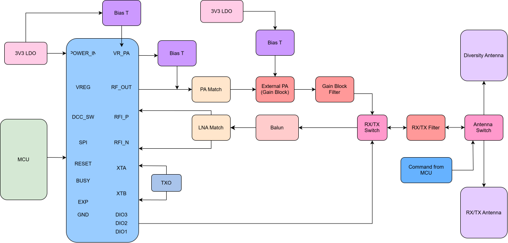

### RF Transceiver High-Level Design

### Oct 3–13, 2026: RF Fundamentals and Impedance Matching

1. Studied transmission line theory, RF wave propagation, reflection coefficients, and transmission line losses.
2. Explored transmission line termination conditions, including open circuits, short circuits, and quarter-wave impedance transformers.
3. Learned about S-parameters and Smith charts for analyzing RF network performance and impedance matching.
4. Investigated parasitic impedance, component non-idealities, and self-resonant frequencies.
5. Studied Q factor, maximum power transfer, and impedance matching techniques using L- and T-networks.
6. Practiced designing and simulating basic impedance matching networks in LTspice.

### Oct 13 - 19, 2026: LTSpice Simulations

1. Simulated RF front-end chain in LTSpice, completed 80% of impedance matching and filtering for TX chain
2. Simulated with real-world components, still making sure it can meet power requirements
3. Finished RFO -> Gain Block, Gain Block -> RX/TX Switch
4. Started designing RF schematic 